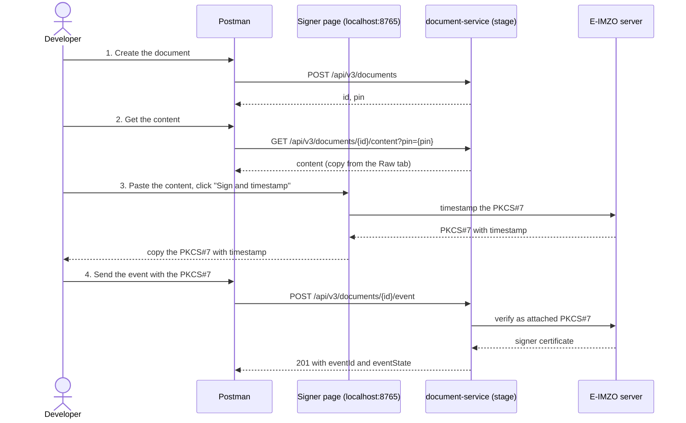
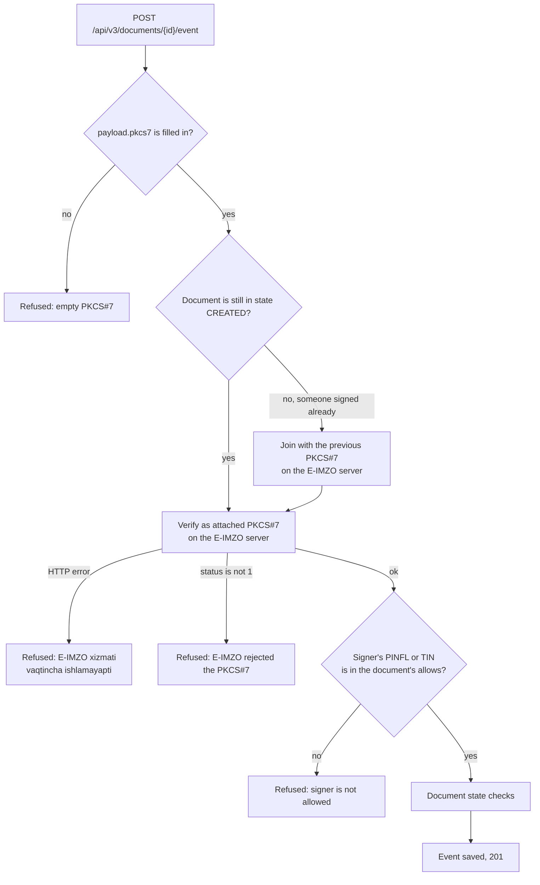
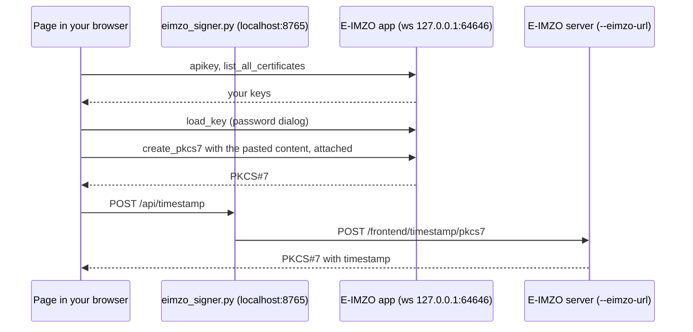

# E-IMZO signer

**English** | [Русский](README.ru.md)

A local page that signs content with your E-IMZO key and timestamps the result. You paste the content, it gives you
the PKCS#7 to put into the `pkcs7` field of a document-service event request.

One Python file, standard library only. Nothing to install.

## Before you start

- Python 3.9 or newer.
- The E-IMZO desktop app is running and your `.pfx` key is in the place where E-IMZO normally finds it (the key shows
  up on any site that signs with E-IMZO).

## Run it

```bash
python3 tools/eimzo-signer/eimzo_signer.py
```

Open <http://localhost:8765>. The address must be `localhost` or `127.0.0.1`: the E-IMZO API keys in the page only
work for those two.

| Option | Default | What it is |
|---|---|---|
| `--port` | `8765` | Port of the local page |
| `--eimzo-url` | `https://hujjat.uz/mobile-id` | E-IMZO server that adds the timestamp |

The default `--eimzo-url` is the E-IMZO server on the production host. The dev backend calls the same server, and
the tool only sends it the PKCS#7 for timestamping.

## Use the page

1. **Key.** The page lists your keys when it opens. Pick one. "Reload keys" asks E-IMZO again.
2. **Content.** Paste the content into the box. It is signed exactly as pasted, as UTF-8, without trimming.
3. **"Sign and timestamp".** E-IMZO asks for the key password the first time. When it finishes, the first box holds
   the plain attached PKCS#7 and the second box holds the timestamped one. Each has a Copy button.

The grey log at the bottom shows each step. A failed timestamp call shows the HTTP status and the response body of
the E-IMZO server.

## Signing a document through Postman

The full flow, from an empty Postman tab to a signed document. All requests go to the gateway
(`https://stage.hujjat.uz`) with your bearer token.



1. **Create the document.** `POST /api/v3/documents` with `"signType": "EIMZO"` and the signer's PINFL or TIN in
   `signParams.allows`. Keep `id` and `pin` from the response (`DocumentRes.java`).
   ```json
   {
     "documentType": "DOC",
     "documentParams": { "templateSourceContent": "<base64 template>", "lang": "ru", "model": {}, "signTemplateUrls": {}, "script": ";" },
     "signType": "EIMZO",
     "signParams": { "allowLevel": "ALL", "allows": ["<PINFL or TIN of the signer>"] },
     "attributes": {}
   }
   ```
2. **Get the content.** `GET /api/v3/documents/{id}/content?pin={pin}`. Copy the body from the **Raw** tab of the
   response. The Pretty tab reformats the JSON, and then you sign different bytes than the document holds.
3. **Sign and timestamp.** Paste the content into the page and click "Sign and timestamp". Copy the box
   "PKCS7 with timestamp".
4. **Send the event.** `POST /api/v3/documents/{id}/event` with headers `version: 3` and
   `Content-Type: application/json` (`EventController.java:48`):
   ```json
   {
     "pin": "<pin>",
     "eventType": "ACCEPT",
     "signType": "EIMZO",
     "payload": { "pkcs7": "<PKCS7 with timestamp>" },
     "withoutCallback": true
   }
   ```
   A `201` with `eventId` and `eventState` means the signature was accepted.

Notes on the event body:

- `withoutCallback: true` skips the webhook call to the document's owner (`EIMZOHandler.java:193`). Leave it out to
  get the callback.
- `payload.signMethod` and `payload.signerId` are required only by `/event/silent`
  (`EIMZODesktopAppValidator.java:63`). The regular `/event` does not need them.
- To reject instead of accept, send `"eventType": "REJECT"` with a `"note"` (`EventCreateReq.java`).

### What the backend does with the PKCS#7

Each "Refused" box is an error answer to the event request (`EIMZODesktopAppValidator.java`, `EIMZOService.java`).



The join step runs only for `ACCEPT` on a document whose sign type is not `DYNAMIC`
(`EIMZODesktopAppValidator.java:88`).

### Mistakes that make the backend refuse the PKCS#7

| Mistake | Why it fails |
|---|---|
| `create_pkcs7` called with `"yes"` as the third argument | That makes a detached PKCS#7 with no content inside. The backend verifies with `/backend/pkcs7/verify/attached` (`EIMZOClient.java`). Use `"no"`, which is what this page does. |
| No timestamp step | The web frontend always timestamps before it submits. See the open question under "How the page works". |
| The signer is not in `signParams.allows` | The certificate's PINFL or TIN must match an allow of the document (`EIMZODesktopAppValidator.java:127`). |
| PKCS#7 pasted with line breaks or cut short | The base64 must arrive whole, as one string. Use the Copy button. |

When the event answers `E-IMZO xizmati vaqtincha ishlamayapti`, the backend's own call to the E-IMZO server failed
with an HTTP error (`EIMZOService.java:41`). The status is in the document-service log, next to
`[EIMZO_CLIENT] Eimzo Verifying the pkcs7 error`.

## How the page works



- The page talks to the E-IMZO app directly. The app only speaks WebSocket, and its password dialog needs a desktop
  session.
- The Python server exists because a browser page may not call the E-IMZO server cross-origin. It forwards that one
  call and nothing else, and it listens on `127.0.0.1` only.
- The PKCS#7 is attached, because the backend verifies with `/backend/pkcs7/verify/attached` (`EIMZOClient.java`).
- The timestamp step mirrors the web frontend, which timestamps before it submits
  (`hujjat-frontend/apps/hujjat-core/composables/useDocument.ts:59`). **Open question:** whether the backend accepts an
  untimestamped PKCS#7 is not confirmed.

## When something fails

| Log line | Meaning | What to do |
|---|---|---|
| `E-IMZO is not reachable at ws://127.0.0.1:64646` | The E-IMZO app is not running | Start it, then "Reload keys" |
| `found 0 key(s)` | E-IMZO sees no `.pfx` | Put the key where E-IMZO expects it, then "Reload keys" |
| `E-IMZO: ...` after the password dialog | Wrong password, or the dialog was cancelled | Click "Sign and timestamp" again |
| `timestamp -> HTTP ...` or `timestamp refused` | The E-IMZO server rejected the PKCS#7 | Read the body in the log; the plain PKCS#7 is still in the first box |
| `timestamp -> HTTP 502` with `CERTIFICATE_VERIFY_FAILED` | Your Python has no root certificates | On macOS with python.org Python, run "Install Certificates.command" |
| `Address already in use` on start | Something else holds the port | Stop it, or pass `--port` |

## Limits

- One signer per run. Joining a second signature onto an existing PKCS#7 is left to the backend.
- Attached PKCS#7 only.
- Text content only: the paste box cannot hold binary content.
- ID-card and USB-token keys are not listed, only `.pfx` files.
