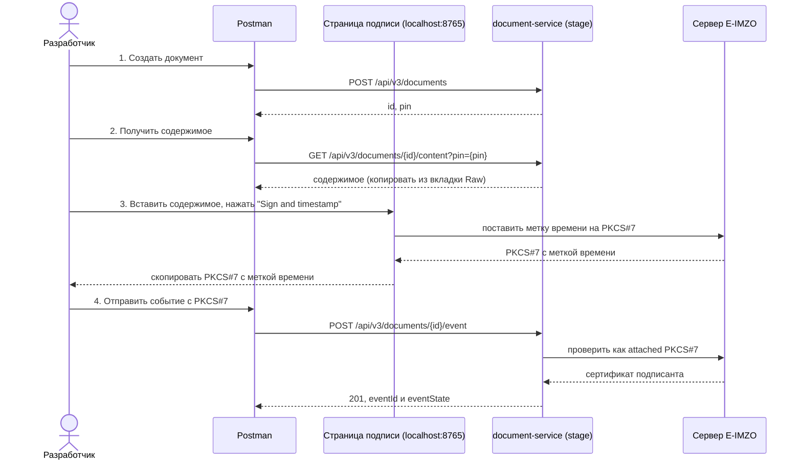
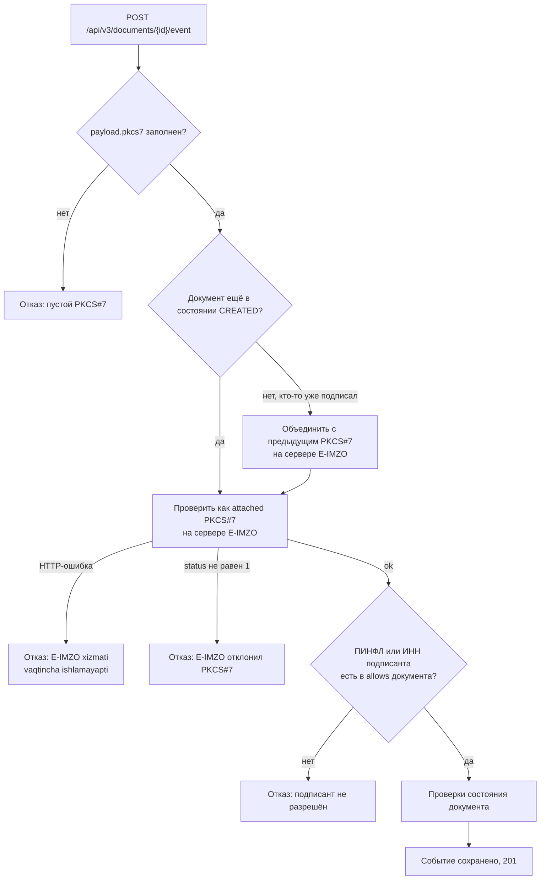
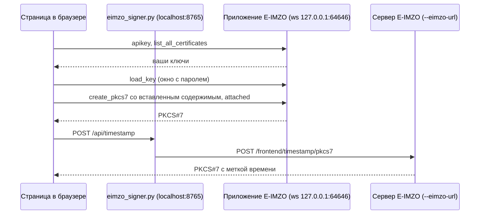

# E-IMZO signer

[English](README.en.md) | **Русский**

Локальная страница, которая подписывает содержимое вашим ключом E-IMZO и ставит на подпись метку времени. Вы
вставляете содержимое, она отдаёт PKCS#7 для поля `pkcs7` в запросе события document-service.

Один файл на Python, только стандартная библиотека. Устанавливать ничего не нужно.

## Что нужно заранее

- Python 3.9 или новее.
- Запущено приложение E-IMZO, и ваш ключ `.pfx` лежит там, где E-IMZO его обычно находит (ключ виден на любом сайте,
  где подписывают через E-IMZO).

## Запуск

```bash
python3 tools/eimzo-signer/eimzo_signer.py
```

Откройте <http://localhost:8765>. Адрес должен быть `localhost` или `127.0.0.1`: API-ключи E-IMZO на странице
работают только для этих двух адресов.

| Параметр | По умолчанию | Что это |
|---|---|---|
| `--port` | `8765` | Порт локальной страницы |
| `--eimzo-url` | `https://hujjat.uz/mobile-id` | Сервер E-IMZO, который ставит метку времени |

`--eimzo-url` по умолчанию указывает на сервер E-IMZO на продакшен-хосте. Dev-бэкенд обращается к тому же серверу, а
инструмент отправляет туда только PKCS#7 для метки времени.

## Работа со страницей

1. **Ключ.** При открытии страница показывает ваши ключи. Выберите нужный. Кнопка "Reload keys" запрашивает список у
   E-IMZO заново.
2. **Содержимое.** Вставьте содержимое в поле. Оно подписывается ровно в том виде, в каком вставлено: в UTF-8, без
   обрезки пробелов и переводов строк.
3. **"Sign and timestamp".** В первый раз E-IMZO спросит пароль ключа. После завершения в первом поле будет обычный
   PKCS#7 (attached), во втором — PKCS#7 с меткой времени. У каждого поля есть кнопка Copy.

Серый лог внизу показывает каждый шаг. Если запрос метки времени не прошёл, в логе будут HTTP-статус и тело ответа
сервера E-IMZO.

## Подписание документа через Postman

Полный путь от пустой вкладки Postman до подписанного документа. Все запросы идут на шлюз
(`https://stage.hujjat.uz`) с вашим bearer-токеном.



1. **Создайте документ.** `POST /api/v3/documents` с `"signType": "EIMZO"` и ПИНФЛ или ИНН подписанта в
   `signParams.allows`. Сохраните `id` и `pin` из ответа (`DocumentRes.java`).
   ```json
   {
     "documentType": "DOC",
     "documentParams": { "templateSourceContent": "<шаблон в base64>", "lang": "ru", "model": {}, "signTemplateUrls": {}, "script": ";" },
     "signType": "EIMZO",
     "signParams": { "allowLevel": "ALL", "allows": ["<ПИНФЛ или ИНН подписанта>"] },
     "attributes": {}
   }
   ```
2. **Получите содержимое.** `GET /api/v3/documents/{id}/content?pin={pin}`. Копируйте тело из вкладки **Raw**.
   Вкладка Pretty переформатирует JSON, и вы подпишете не те байты, которые хранит документ.
3. **Подпишите и поставьте метку времени.** Вставьте содержимое на страницу и нажмите "Sign and timestamp".
   Скопируйте поле "PKCS7 with timestamp".
4. **Отправьте событие.** `POST /api/v3/documents/{id}/event` с заголовками `version: 3` и
   `Content-Type: application/json` (`EventController.java:48`):
   ```json
   {
     "pin": "<pin>",
     "eventType": "ACCEPT",
     "signType": "EIMZO",
     "payload": { "pkcs7": "<PKCS7 с меткой времени>" },
     "withoutCallback": true
   }
   ```
   Ответ `201` с `eventId` и `eventState` означает, что подпись принята.

Про тело события:

- `withoutCallback: true` отключает вызов вебхука владельцу документа (`EIMZOHandler.java:193`). Уберите поле, если
  колбэк нужен.
- `payload.signMethod` и `payload.signerId` обязательны только для `/event/silent`
  (`EIMZODesktopAppValidator.java:63`). Обычному `/event` они не нужны.
- Чтобы отклонить документ, отправьте `"eventType": "REJECT"` и `"note"` (`EventCreateReq.java`).

### Что бэкенд делает с PKCS#7

Каждый блок "Отказ" — это ответ с ошибкой на запрос события (`EIMZODesktopAppValidator.java`, `EIMZOService.java`).



Шаг объединения выполняется только для `ACCEPT` и только если тип подписи документа не `DYNAMIC`
(`EIMZODesktopAppValidator.java:88`).

### Ошибки, из-за которых бэкенд отклоняет PKCS#7

| Ошибка | Почему не работает |
|---|---|
| `create_pkcs7` вызван с `"yes"` в третьем аргументе | Получается detached PKCS#7 без содержимого внутри. Бэкенд проверяет через `/backend/pkcs7/verify/attached` (`EIMZOClient.java`). Нужно `"no"`, как делает эта страница. |
| Нет шага с меткой времени | Веб-фронтенд всегда ставит метку времени перед отправкой. См. открытый вопрос в разделе "Как работает страница". |
| Подписанта нет в `signParams.allows` | ПИНФЛ или ИНН из сертификата должен совпасть с одним из allows документа (`EIMZODesktopAppValidator.java:127`). |
| PKCS#7 вставлен с переводами строк или обрезан | Base64 должен прийти целиком, одной строкой. Пользуйтесь кнопкой Copy. |

Если событие отвечает `E-IMZO xizmati vaqtincha ishlamayapti`, значит запрос самого бэкенда к серверу E-IMZO
завершился HTTP-ошибкой (`EIMZOService.java:41`). Статус есть в логе document-service рядом со строкой
`[EIMZO_CLIENT] Eimzo Verifying the pkcs7 error`.

## Как работает страница



- Страница общается с приложением E-IMZO напрямую. Приложение понимает только WebSocket, а его окну с паролем нужен
  рабочий стол.
- Сервер на Python нужен потому, что странице в браузере нельзя обращаться к серверу E-IMZO с другого origin. Он
  пересылает только этот один запрос и слушает только `127.0.0.1`.
- PKCS#7 создаётся attached, потому что бэкенд проверяет через `/backend/pkcs7/verify/attached` (`EIMZOClient.java`).
- Шаг с меткой времени повторяет веб-фронтенд, который ставит её перед отправкой
  (`hujjat-frontend/apps/hujjat-core/composables/useDocument.ts:59`). **Открытый вопрос:** не подтверждено, принимает
  ли бэкенд PKCS#7 без метки времени.

## Если что-то не работает

| Строка в логе | Что это значит | Что делать |
|---|---|---|
| `E-IMZO is not reachable at ws://127.0.0.1:64646` | Приложение E-IMZO не запущено | Запустите его и нажмите "Reload keys" |
| `found 0 key(s)` | E-IMZO не видит ни одного `.pfx` | Положите ключ туда, где его ждёт E-IMZO, и нажмите "Reload keys" |
| `E-IMZO: ...` после окна с паролем | Неверный пароль, или окно закрыли | Нажмите "Sign and timestamp" ещё раз |
| `timestamp -> HTTP ...` или `timestamp refused` | Сервер E-IMZO отклонил PKCS#7 | Прочитайте тело ответа в логе; обычный PKCS#7 остался в первом поле |
| `timestamp -> HTTP 502` с `CERTIFICATE_VERIFY_FAILED` | У вашего Python нет корневых сертификатов | На macOS с Python от python.org запустите "Install Certificates.command" |
| `Address already in use` при запуске | Порт занят другим процессом | Остановите его или укажите `--port` |

## Ограничения

- Один подписант за запуск. Добавление второй подписи к существующему PKCS#7 делает бэкенд.
- Только attached PKCS#7.
- Только текстовое содержимое: в поле нельзя вставить бинарные данные.
- Ключи на ID-карте и USB-токене не показываются, только файлы `.pfx`.
